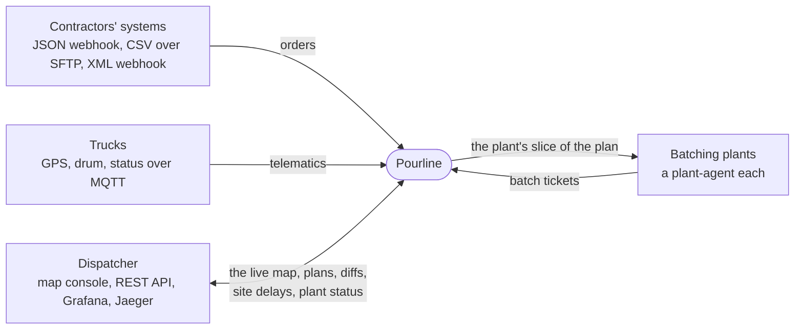
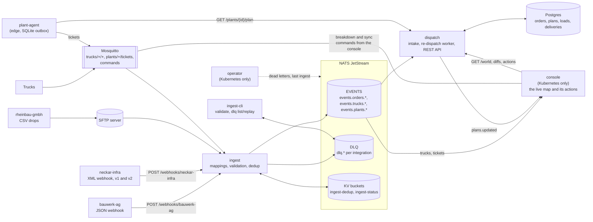
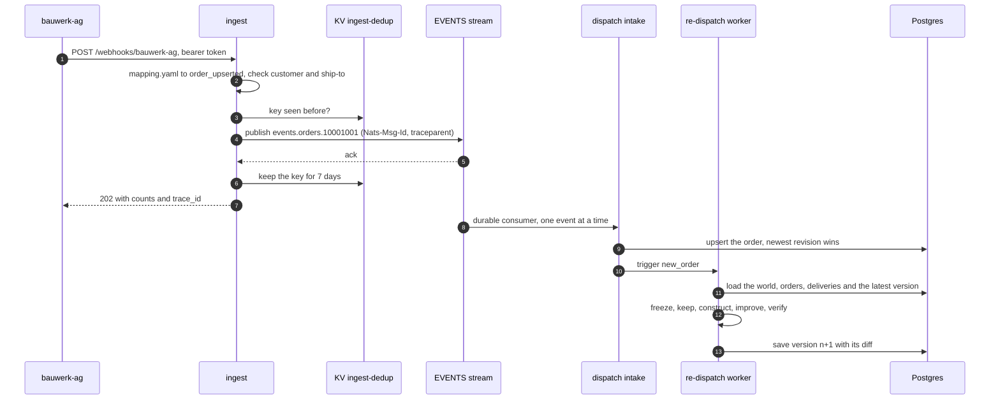
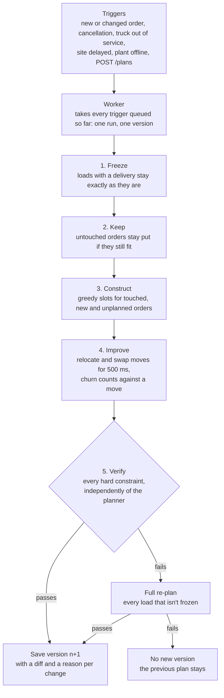
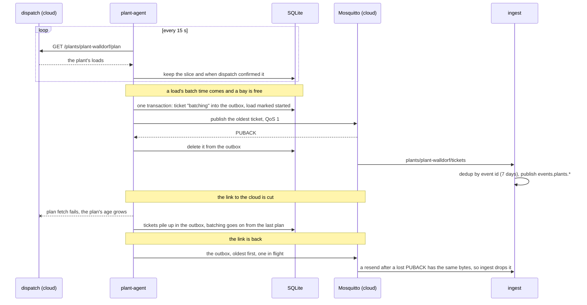
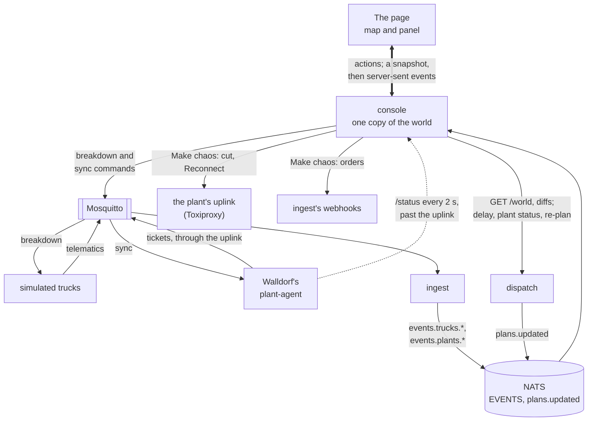
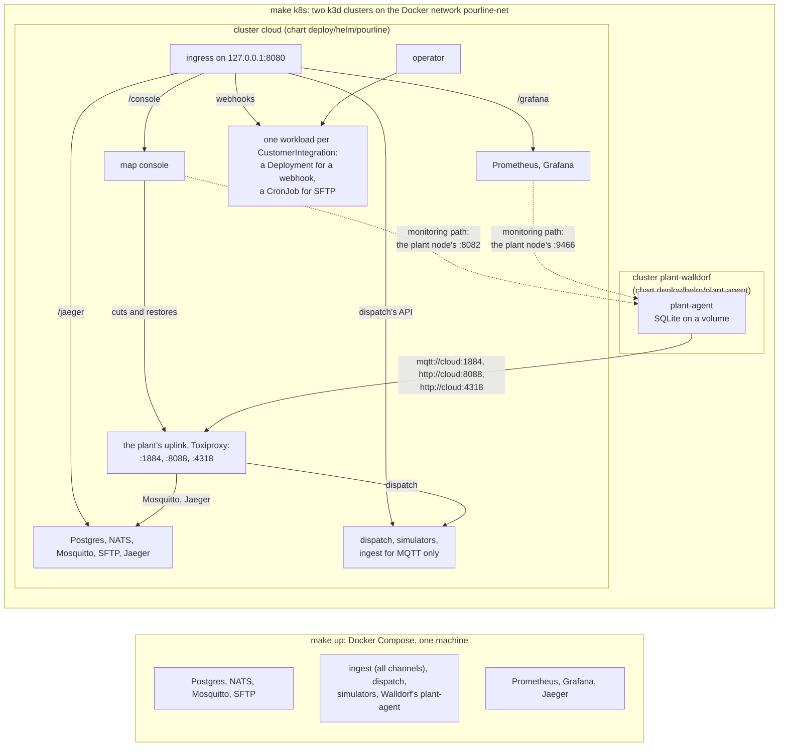
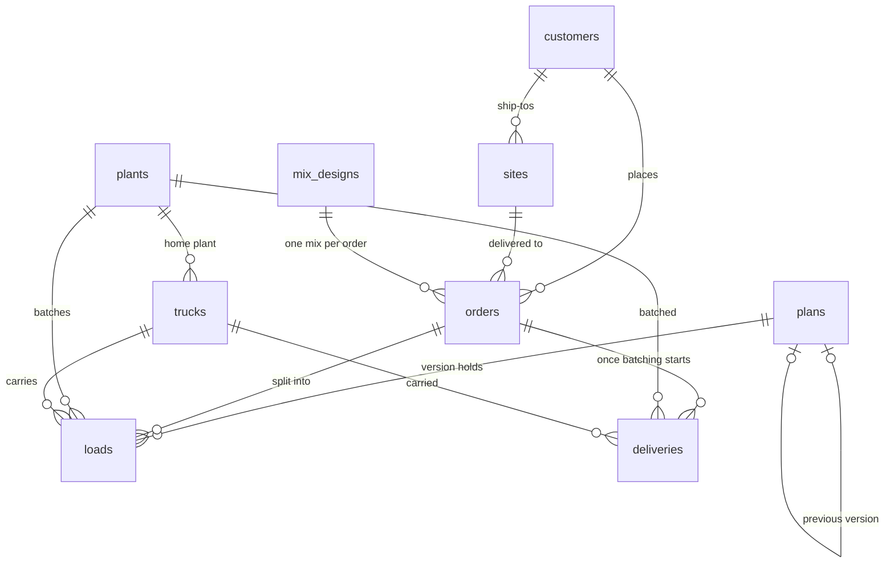
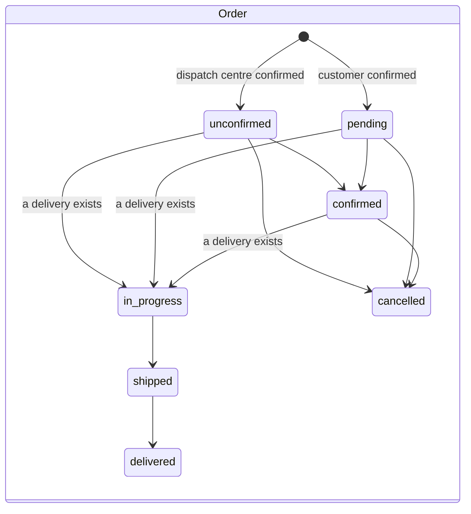

# Pourline architecture

Pourline dispatches ready-mix concrete trucks from batching plants to construction sites. It takes
in customer orders and truck telematics, keeps a plan of truck loads, and repairs that plan when
reality changes. It runs in the cloud, plus an edge agent at each plant that keeps working when the
link to the cloud is down. [SPEC.md](../SPEC.md) says what it should do; this document says how it
does it. The [ADRs](adr/) record why.

## Contents

1. [Context](#context)
2. [Services](#services)
3. [An order's path](#an-orders-path)
4. [Re-dispatch](#re-dispatch)
5. [The edge](#the-edge)
6. [The map console](#the-map-console)
7. [Deployment](#deployment)
8. [Domain model](#domain-model)
9. [Cross-cutting rules](#cross-cutting-rules)
10. [Decisions](#decisions)

## Context

Everything outside Pourline is simulated (`crates/simulators`): 25 trucks, three plants and three
contractors in the Rhine-Neckar area, from [`deploy/seed/rhine-neckar.json`](../deploy/seed/rhine-neckar.json).
Customers, ship-tos, plants, trucks and mix designs are Pourline's own master data. Customers never
send them: an order names our customer number and ship-to number.

## Services

| Crate | What it does |
|---|---|
| [`domain`](../crates/domain) | Shared types: master data, orders, loads, deliveries, canonical events, the seed loader |
| [`ingest`](../crates/ingest) | Webhooks, an SFTP poller and an MQTT subscriber in; canonical events on JetStream out. Every customer format is a [mapping](../customers) (ADR 0003) |
| [`ingest-cli`](../crates/ingest-cli) | `validate` a customer's sample file against its mapping; `dlq list` and `dlq replay` after a mapping fix |
| [`dispatch`](../crates/dispatch) | Keeps Postgres in step with the events, plans and re-plans, serves the REST API with OpenAPI at `/swagger-ui/` |
| [`plant-agent`](../crates/plant-agent) | At a plant: batches from its slice of the plan, store-and-forward through a SQLite outbox (ADR 0004) |
| [`operator`](../crates/operator) | Runs each `CustomerIntegration` resource as its own ingest workload, and reports its status |
| [`console`](../crates/console) | The map console, in Kubernetes: the live fleet, the latest plan and its diff, the plant's edge, and actions that change the world |
| [`telemetry`](../crates/telemetry) | Shared tracing, OTLP export and the Prometheus listener |
| [`simulators`](../crates/simulators) | The fake world: trucks, plants, contractors, plus the `demo` scenario |

Each service reads its configuration from environment variables with defaults; the README lists
them per service, and [`.env.example`](../.env.example) collects the ones worth overriding.

## An order's path

A bauwerk-ag order, from their webhook to a new plan version, is one trace in Jaeger:

- A record that fails its mapping or master data goes to `dlq.<integration>` with every reason,
  and the webhook still answers `202` with a dead-letter count. `ingest-cli dlq replay` sends it
  through again after the mapping is fixed.
- If NATS is down, the webhook answers `503` with `Retry-After`, MQTT messages stay unacknowledged
  at the broker, and SFTP files stay where they are. Nothing is accepted that isn't in JetStream.
- The other channels look the same from step 4 on. A truck going `out_of_service` arrives as an
  `mqtt message`, and becomes a `TruckOutOfService` trigger.
- The trace is: `webhook` → `publish` → `apply event` → `redispatch` → `load world`, `plan`,
  `save plan`. The context crosses NATS in the message's `traceparent` header.

## Re-dispatch

The hard constraints come from SPEC §4: one load per truck at a time, a load never exceeds the
drum, a plant never batches more loads in parallel than it has loading bays, every load is
discharged within its mix design's time limit, and no out-of-service truck or offline plant is
used. The planner only proposes slots that meet them; [`verify.rs`](../crates/dispatch/src/verify.rs)
checks again without reading the planner's bookkeeping, and the property tests run it on random
worlds.

The soft objectives are a weighted cost: minutes beyond an order's maximum gap (cold joints, by
far the heaviest), every gap minute, lateness, empty kilometres, and churn against the previous
version. The weights are the `WEIGHT_*` variables. Travel times come from a
`TravelTimeProvider` (ADR 0006). Why repair rather than re-optimise: ADR 0002.

## The edge

- The agent never batches a load twice, and a restart resumes a load where it stopped.
- A sync command on `plants/plant-walldorf/commands/sync`, which the map console sends, makes the
  agent fetch its plan at once. The payload is empty or a `traceparent`, which the fetch continues.
- `/status` reports both links, the outbox size, the sync lag and the plan's age; Prometheus scrapes
  the same as metrics.
- Tickets go through ingest like every other source, so they get its validation, DLQ and traces.

## The map console

The map console (`crates/console`) runs in the cloud cluster only. It shows the live world on a
map, and acts on it through dispatch's API, MQTT commands, ingest's webhooks and the plant's
uplink. It keeps one copy of the world for every open page: master data from the seed compiled
into it, and live state from the stack.

- **The live path.** Truck telematics and batch tickets reach the console as canonical events, on
  an ordered consumer that starts at each subject's last message, so every truck and plant has its
  latest event at once. Dispatch announces each version it stores on `plans.updated`, a core NATS
  subject outside the EVENTS stream, and the console fetches its diff. `GET /world` gives the
  starting truck and plant state and the latest version. The console reads it again after each
  announcement and after a NATS reconnect, which catches a version core NATS dropped. Each truck
  field keeps its newest value by report time, whichever way it came.
- **Pages** get a snapshot, then each change as a server-sent event, and a heartbeat with the world
  time every 15 s. A page that falls behind is dropped, and its browser reconnects for a new
  snapshot. A page talks only to the console. Apart from its actions, only a plant's or a site's
  popup makes the console call dispatch for it.
- **Actions** take a real system's paths: dispatch's API for a site delay, a plant's status and a
  re-plan, the simulators' MQTT command for a breakdown, the agent's sync command, and, for Make
  chaos, ingest's webhooks and the uplink's Toxiproxy API. The console never plans, so the hard
  constraints stay with dispatch. Each action is a trace of its own, which dispatch and the
  plant-agent continue. A breakdown's trace ends at its MQTT 3.1.1 command, which has no headers;
  ingest traces the re-dispatch it causes.
- **The uplink** is the plant's only way to the cloud: Toxiproxy on the cloud node, with a proxy
  each for MQTT, dispatch and OTLP. Make chaos disables them, which closes both sides of every
  connection. The console and Prometheus read the agent on the plant node's own address, so a cut
  stays visible on the map and in Grafana.

## Deployment

- **Compose** (`make up`) is the everyday setup. One ingest process runs every channel.
- **Kubernetes** (`make k8s`) shows the production shape. Each customer integration is a
  `CustomerIntegration` resource: its mapping in a ConfigMap, its credentials in a Secret. The
  operator checks the mapping with ingest's own parser before rolling it out, pauses and resumes the
  workload, cleans up through a finalizer, and reports the phase, dead letters and last ingest.
  The map console, Grafana and Jaeger sit behind the ingress, and Prometheus finds its targets in
  the namespace. The plant reaches the cloud only through its uplink, which the console's Make chaos
  cuts. The console and Prometheus watch the plant over its monitoring path, LoadBalancer ports on
  the plant node. `make chaos` is the hard cut: it disconnects the plant node from `pourline-net`
  for two minutes, monitoring path and all.
- **CI** runs `make test`, `make audit`, the end-to-end test (`make e2e`: the cloud chart on kind,
  the demo scenario, then a plan, an empty DLQ, Prometheus's targets and the console's snapshot),
  and builds every image for amd64 and arm64. On `main` it publishes them to
  `ghcr.io/igorilic/rmc-dispatch-platform/<binary>`.

## Domain model

- A **load** is a planned truck trip: an order's sequence number, a volume up to the drum, a plant,
  a truck, a batch time and an ETA. Each plan **version** holds a full set of loads, the triggers
  that caused it and its diff to the previous version.
- A **delivery** exists only once batching starts. Its load is then **frozen**: no re-dispatch
  moves it.
- A site with only an address is placed at its postal code's centroid (`postal_codes`, a
  deliberately fake geocoder).

`in_progress` is derived when an order is read (the `shown_orders` view), so a customer's next
snapshot can't reset it. A delivery's status is the furthest of `batching`, `loading`, `loaded`,
`left_plant`, `arrived_at_customer`, `unloading` and `unloaded` it has reached, so an event that
arrives late never moves it back.

What the code reaches today: every customer mapping turns the customer's confirmation into
`pending` and its cancellation into `cancelled`, and the dispatch centre has no endpoint to confirm
an order yet, so `unconfirmed` and `confirmed` are in the model only. Only plant tickets update
deliveries, up to `loaded`. Nothing reports the later stages per delivery yet, so orders stop at
`in_progress`: `shipped` and `delivered` wait for trucks that report against a load.

## Cross-cutting rules

- **Idempotency.** Every canonical event's id is its idempotency key. JetStream drops a repeat
  within 2 minutes by `Nats-Msg-Id`. Order and batch-ticket keys also stay in the `ingest-dedup`
  KV for `DEDUP_TTL_DAYS`, because SFTP snapshots and outbox resends repeat days or minutes later.
  Dispatch keeps the newest revision of each order by `occurred_at`, so a stale event changes
  nothing.
- **Backpressure.** Every queue is bounded. A full webhook answers `503`, MQTT messages wait at the
  broker until NATS has them, and the re-dispatch queue makes senders wait instead of growing.
- **Ordering.** Dispatch's consumers apply events one at a time in stream order, so a cancellation
  never overtakes the order it cancels. The plant-agent sends one ticket at a time, oldest first.
- **Failure.** NATS calls retry with exponential backoff (0.1 s doubling, 6 attempts). An event that
  can never apply is logged and acknowledged, so it doesn't block the ones behind it.
- **Telemetry.** One trace per delivery, from ingest through NATS into the re-dispatch, and one per
  map console action; a breakdown's re-dispatch gets a second, from ingest, because MQTT 3.1.1
  carries no headers. Dispatch continues a caller's `traceparent` only when the request didn't come
  through the ingress. GPS and drum readings are counted but not traced. Prometheus metrics cover
  ingest throughput per customer, the DLQ size, re-dispatch latency, the pour-gap distribution, the
  edge's sync lag and the console's pages, pushes and actions, on the provisioned "Dispatch
  overview" Grafana dashboard, in compose and in Kubernetes.
- **Configuration.** Environment variables only, each with a documented default.
- **Code rules.** No `unwrap()` or `expect()` outside tests and startup, `thiserror` in libraries and
  `anyhow` in binaries, no customer-specific Rust.

## Decisions

| ADR | Decision |
|---|---|
| [0001](adr/0001-nats-jetstream-over-kafka.md) | NATS JetStream over Kafka |
| [0002](adr/0002-repair-based-redispatch.md) | Repair-based re-dispatch instead of full re-optimisation |
| [0003](adr/0003-declarative-customer-mappings.md) | Declarative per-customer mappings instead of per-customer code |
| [0004](adr/0004-sqlite-outbox-at-the-edge.md) | SQLite outbox for edge store-and-forward |
| [0005](adr/0005-monorepo-cargo-workspace.md) | One repository, one Cargo workspace (with one exception) |
| [0006](adr/0006-haversine-travel-time-behind-a-trait.md) | Haversine travel time behind a trait, and when to switch to OSRM |
